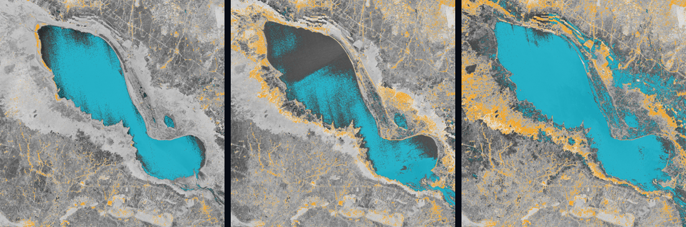

# DELTA PULSE: Revealing the Water We Cannot See

**Team RADAR UNIT · NASA Space Apps Challenge 2026 · "Dancing with the SARs"**

DELTA PULSE uses NASA-ISRO **NISAR L-band radar** to show water that cameras miss: floodwater spreading **under forest canopy**, and water hidden by cloud or darkness. Type any place on Earth and the app searches NASA's ASF archive live, reads only the needed parts of the real NISAR files, and shows what changed. Every statement is labelled **OBSERVED**, **CALCULATED**, **INTERPRETED** or **UNCONFIRMED**, so the app never claims a flood it cannot prove.

**Case study, Tonle Sap Lake (Cambodia), 10 NISAR passes, Jun–Oct 2026:** the radar class that matches flooded forest grew about sixfold, from 293 to 1,721 km² at its 11 Sep peak, and water-like ground grew by about 62%. ERA5 cloud cover was above 50% at 9 of the 10 pass times.


*NISAR HH radar over Tonle Sap during the 2026 season. Cyan: water-like low backscatter. Orange: double-bounce signature consistent with water under trees. Screening classes, uncalibrated (see [LIMITATIONS](radar/LIMITATIONS.md)).*

## Start here
| | |
|---|---|
| **The app and how to run it** | [radar/README.md](radar/README.md) |
| **For judges** | [radar/SUBMISSION.md](radar/SUBMISSION.md) |
| **User manual** | [radar/USER_MANUAL.md](radar/USER_MANUAL.md) (also `/guide` in the app) |
| **Science and methods** | [radar/SCIENCE.md](radar/SCIENCE.md) · [radar/LIMITATIONS.md](radar/LIMITATIONS.md) |
| **Live backend** | [radar/BACKEND.md](radar/BACKEND.md) |

## Quick start
```bash
cd radar
npm install
npm run dev        # http://localhost:3000, Tonle Sap case study and Your Story work without the backend
```
Live search anywhere on Earth also needs the Python backend and a free NASA Earthdata token (see [radar/BACKEND.md](radar/BACKEND.md)).

DELTA PULSE is a student project and is not an official NASA product.
